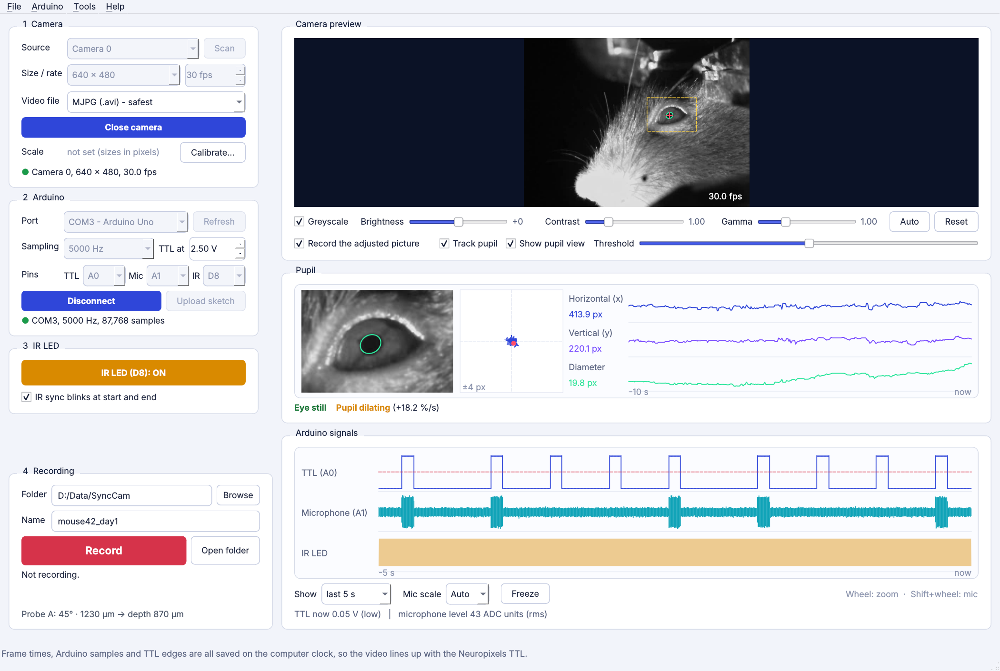
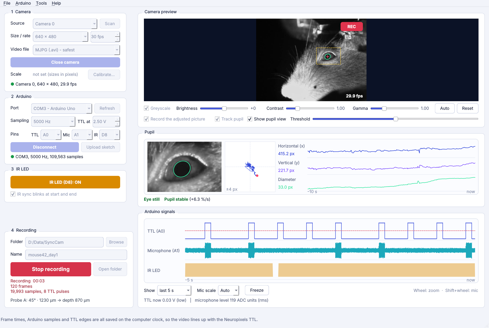
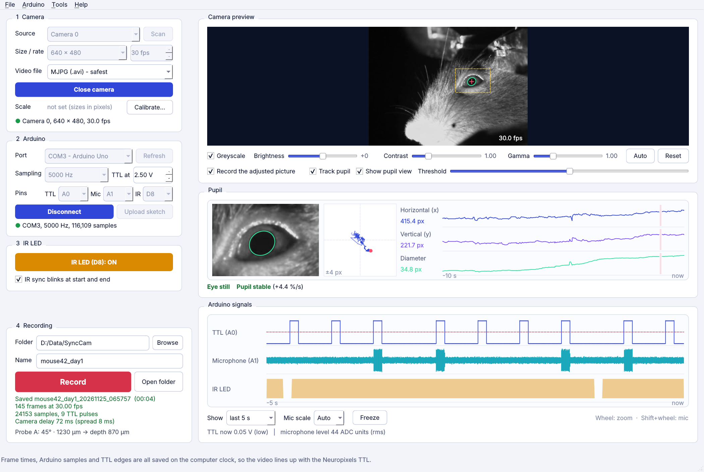
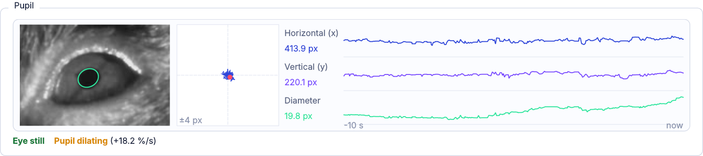
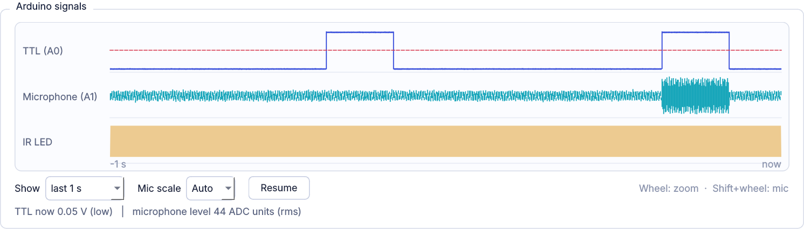
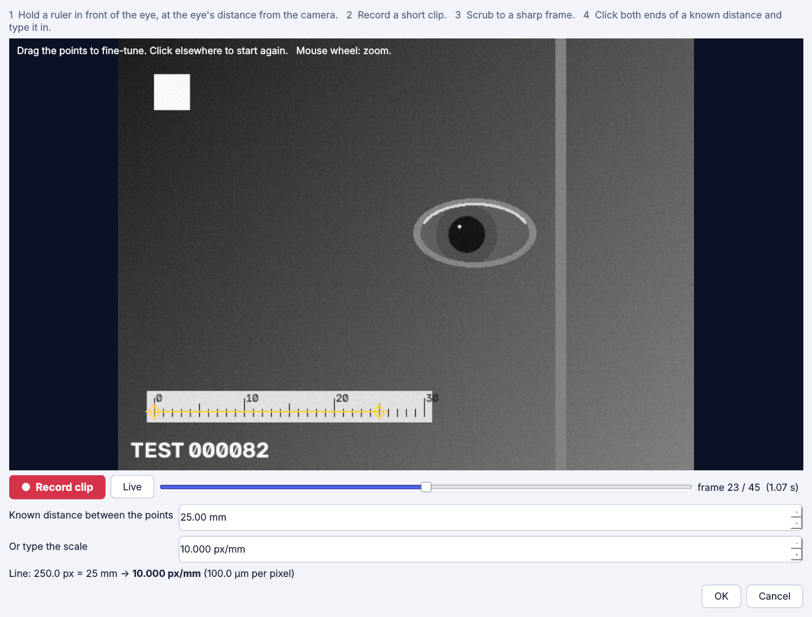
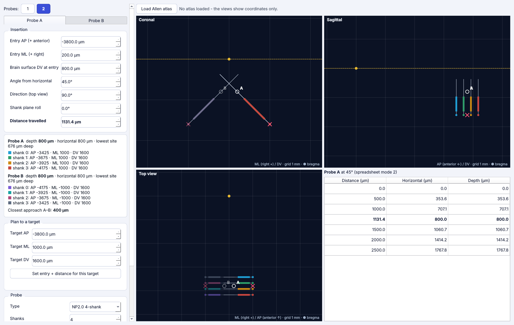

# SyncCam

Records video from a USB camera together with signals that an Arduino samples:

- the **TTL sync signal** that also goes to the Neuropixels (OneBox / Open Ephys), on A0
- a **microphone**, on A1
- an **IR LED** that the Arduino switches on and off, on D8

Every video frame, every Arduino sample and every TTL edge is saved on the same clock.
For each TTL pulse you get the video frame at that moment, and the sound at the same
sample, so video, sound and the Neuropixels recording line up through the shared TTL.

Windows 10/11 and macOS (Apple silicon and Intel).

<table>
<tr>
<td width="50%"> <b>Recording</b>: video, TTL, sound and IR LED on one clock</td>
<td width="50%"> <b>Saved</b>: frames, TTL pulses and the measured camera delay</td>
</tr>
<tr>
<td> <b>Pupil tracking</b>: close-up, x–y trail, position and diameter in mm</td>
<td> <b>Zoomed signals</b>: a TTL pulse and the sound burst it gates</td>
</tr>
<tr>
<td> <b>Calibration</b>: record a clip of a ruler, scrub, click a known distance</td>
<td> <b>Probe planner</b>: two angled Neuropixels probes, coronal / sagittal / top views</td>
</tr>
</table>

## Download

Get the installer for your computer from the [latest release](https://github.com/jerjely/SyncCam/releases/latest):

| Your computer | File |
|---|---|
| Windows 10 / 11 | `SyncCam-x.y.z-Windows-setup.exe` |
| Mac with Apple silicon (M1 or newer) | `SyncCam-x.y.z-macOS-AppleSilicon.pkg` |
| Mac with an Intel processor | `SyncCam-x.y.z-macOS-Intel.pkg` |

The installers are not code-signed:

- **Windows:** click **More info** → **Run anyway**. No administrator rights are needed.
- **Mac:** if macOS refuses to open the .pkg, go to **System Settings → Privacy & Security** and click **Open Anyway**.
  The first time you open a camera, macOS asks for camera access. Click **Allow**. If you clicked
  **Don't Allow**, turn SyncCam on under **Privacy & Security → Camera**, then open the camera again.

## Arduino

The Arduino needs the SyncCam sketch (it replaces e.g. Firmata):

- **Uno or Nano:** SyncCam does it for you. Plug the board in, choose its port, and click
  **Upload sketch** (or **Arduino → Upload sketch to board**). No Arduino IDE needed. It takes
  a few seconds and checks the result.
- **Other boards** (Nano Every, Uno R4, Leonardo, Mega): download `SyncCam-x.y.z-Arduino-sketch.zip`
  from the release (or **Arduino → Save sketch (.ino)** in the app) and upload it with the
  Arduino IDE.

The sketch source is `firmware/SyncCam_Arduino/SyncCam_Arduino.ino`. After changing it, rebuild
the bundled firmware with `python tools/build_firmware.py <ArduinoCore-avr folder>` (see the
script for the one-time setup); the self-test fails if the two do not match.

These are the default pins. You can pick other pins in the app (**Arduino → Pins**:
TTL and microphone on any of A0–A7, IR LED on D2–D13). The choice is sent to the board each
time you connect, so you never need to re-upload the sketch. A6 and A7 exist only on the Nano.

| Arduino pin (default) | Connect to |
|---|---|
| A0 | TTL sync signal (the same TTL that goes to the Neuropixels), 0–5 V |
| A1 | Microphone module output (MAX4466, MAX9814 or similar, biased at about 2.5 V) |
| D8 | IR LED through a resistor (for example 180 Ω for a 20 mA LED), or a transistor/MOSFET for brighter LEDs |
| GND | Common ground with the TTL source and the microphone |

The sketch samples both analog inputs at the chosen rate (1–10 kHz, default 5 kHz, 10-bit) and
streams them at 1,000,000 baud. Each sample carries a counter, so lost samples are detected and
reported. Commands are documented at the top of the sketch.

## Using it

1. **Camera:** pick the camera (**Scan** finds connected ones), size and frame rate, then **Open camera**.
2. **Arduino:** pick the port, check the pins match your wiring, and **Connect**. The board restarts when the port opens, which takes about 2 s.
   Set the TTL threshold (default 2.5 V). The red dashed line in the TTL plot shows it.
3. **IR LED:** click the button to switch it on or off. It stays as you set it, and SyncCam remembers
   the setting next time you connect.
4. **Picture:** under the preview, **Greyscale** is on by default. Adjust **Brightness**, **Contrast**
   and **Gamma**, or click **Auto** to set brightness and contrast from the current picture. With
   **Record the adjusted picture** ticked (the default), the video file looks like the preview. Untick it
   to record the camera's original image and use the adjustments only for viewing.
5. **Signals:** choose how much to show (50 ms to 10 s) and the microphone scale, or use the mouse
   wheel over the plot (Shift + wheel for the microphone). **Freeze** holds the plot so you can look closely.
6. **Pupil (optional):** tick **Track pupil**, then drag a box around the eye in the camera picture.
   Leave some room around the eye so a fully dilated pupil still fits. SyncCam finds the pupil in
   every frame and shows its outline, an enlarged close-up of the eye, an x–y trail and live traces of
   horizontal position, vertical position and diameter. **Show pupil view** hides all of that, while
   tracking and saving carry on. If the outline is too small or spills over the iris, move the
   **Threshold** slider (the pixels counted as pupil show in red while you move it). Under the plots
   a live readout says whether the eye is still or moving (and which way) and whether the pupil is
   stable, dilating or constricting.
7. **Calibration (optional, for millimetres):** with the camera open, click **Calibrate...** next to
   *Scale*. Hold a ruler in front of the eye, at the eye's distance from the camera, click **Record clip**,
   then **Stop**. Scrub with the slider (or the arrow keys; Shift+arrow jumps 10 frames) to a frame where
   the ruler is sharp, click both ends of a known distance (zoom with the mouse wheel and drag the points to
   fine-tune), type the distance in mm and click OK. You can also type a known scale directly. The scale is
   remembered, together with the picture size it was measured at: after a resolution change SyncCam asks
   you to calibrate again rather than giving wrong millimetres.
8. **Recording:** choose a folder and a name, then **Record** and **Stop recording**.

**Simulator (no hardware)** and **Test pattern (no camera)** let you try everything without hardware.

## What gets saved

Each recording goes into its own folder, `<name>_<date>_<time>/`:

| File | Contents |
|---|---|
| `video.avi` (or `.mp4`) | The camera video |
| `frames.csv` | For every frame: `time_s`, `time_exposure_s` (when the camera delay was measured, see *IR sync blinks*), wall clock, the matching Arduino `sample`, `brightness` (mean grey level). With pupil tracking on: `pupil_found`, `pupil_x`, `pupil_y`, `pupil_diameter`, `pupil_quality` (pixels; plus `pupil_x_mm`, `pupil_y_mm`, `pupil_diameter_mm` with a calibration), then `pupil_minor`, `eye_speed_px_s`, `eye_moving`, `pupil_change_pct_s`, `pupil_state` (plus `pupil_minor_mm`, `eye_speed_mm_s`) |
| `ttl_events.csv` | Every TTL rising and falling edge: `sample`, `time_s`, `video_frame`, `frame_time_s`; with a measured camera delay also `video_frame_exposure`, `frame_exposure_time_s` (the frame *exposed* at that moment) |
| `microphone.wav` | The microphone, centred and amplified so you can listen to it |
| `analog.wav` | 3 channels at the sample rate, raw values: TTL (0–1023), microphone (0–1023), IR LED (0/1) |
| `session.json` | Settings (including pins, picture adjustments and the calibration with how and when it was measured), measured frame rate, Arduino clock fit, drop counts, `camera_delay` (per-blink values, median, spread), `probe` (the probe plan, see below) |

All `time_s` values are seconds since **Record** was pressed, on the computer's clock.
Arduino sample *n* happened at `first_sample_time_s + n / measured_rate_hz` (both in `session.json`).

**Use `frames.csv` for frame times,** not the frame rate written in the video file. USB cameras
never run at exactly their nominal rate. The file's header uses the rate measured just before recording.

### How video, sound and TTL line up

- **TTL and sound** are sampled together by the Arduino, so sample *n* of `microphone.wav`
  is the same moment as sample *n* of the TTL. The `sample` column of `ttl_events.csv` points
  straight into the sound file.
- **TTL and video:** each row of `ttl_events.csv` gives the `video_frame` at the moment of that
  edge (the first frame that reached the computer at or after it) and that frame's time.
- **Video and sound:** `frames.csv` gives the matching Arduino sample for every frame.

To line up with the Neuropixels, match the TTL edges in `ttl_events.csv` to the TTL events
in Open Ephys / SpikeGLX (they are the same pulses), then read off the video frame or the
sound sample for any Neuropixels time.

Frame times (`time_s`) are when each frame reached the computer, which is a little after its exposure
(typically one or two frame intervals for USB cameras). With the IR LED on, SyncCam measures this
delay in every recording with **IR sync blinks** (below) and writes exposure-corrected frame times,
`time_exposure_s`. Use those, and `video_frame_exposure` in `ttl_events.csv`, when you need the
video lined up with the TTL to better than a frame or two.

### IR sync blinks (camera delay)

**IR sync blinks at start and end** (IR LED panel, on by default) works whenever the IR LED is on and
both the camera and the Arduino are connected. About 0.5 s after **Record**, and again just before the
recording ends, the IR LED goes off for 0.1 s, so the picture dims for about three frames. The
recording ends 0.5 s after the second blink (Stop takes about 0.6 s longer).

The Arduino records the exact moments the LED went off and on (`analog.wav` channel 3, on the same
clock as the TTL). For each of the 4 transitions, SyncCam takes the first frame whose brightness
crosses halfway between the normal level and the dip, and computes
**delay = frame time − LED edge time**. The median is the camera delay:

- `session.json → camera_delay`: the per-blink values, `delay_ms` (median), `delay_spread_ms`, and the frame interval;
- `frames.csv`: `time_exposure_s = time_s − delay`, plus the `brightness` of every frame it was measured from;
- the status line after Stop shows it, for example "Camera delay 48 ms (spread 6 ms)".

The delay is known to about ± half a frame: a frame shows the change somewhere within its exposure,
and the first frame showing it can arrive up to one frame interval after the true delay. If
switching the LED off does not visibly darken the picture (an IR LED that is not the camera's
light), the recording says *no visible dip* instead of guessing, and `time_exposure_s` is not written.
The method comes from VisRig (`visrig/camsync.py`, `_ir_blink`).

### Pupil tracking

The detector is VisRig's (`visrig/pupil/detector.py`), with one change. Inside the eye box it blurs
the picture (5 px) and takes everything darker than the darkest 0.2 % of the box plus an offset (20 grey
levels; the **Threshold** slider moves the offset) as possible pupil. A 5 px opening cuts thin bridges to
the dark iris edge or lashes. Among the dark blobs it picks the one with the best roundness × solidity ×
ellipse fill × √area, preferring blobs near the last pupil position, and fits an ellipse to the blob's
convex hull. That way a lid notch or the corneal reflection doesn't bite into the outline. The
*confidence* (roundness × solidity × ellipse fill; a clear pupil gives about 0.9) must be at least
0.6, otherwise the frame counts as lost (blink, half-closed lid, fur): `pupil_found = 0` and empty
values, never a guess. `pupil_quality` is that confidence.

*The change:* only blobs above the confidence limit compete. In VisRig a low-confidence blob near a
wrongly remembered position could win, the frame was then rejected and the remembered position never
updated. On the rig's eye video one dark speck in the fur locked VisRig's detector for about 3,000
frames while the pupil was clearly visible.

On that video (`pupil_video2025-12-08T15_59_24.avi`, 55,872 frames, eye box 340,160,160,130):

| | pupil found | diameter jumps > 3 px | per frame |
|---|---|---|---|
| previous SyncCam tracker | 99.2 % | 1,310 | 2.4 ms |
| VisRig detector | 94.0 % | 35 | 0.37 ms |
| SyncCam now | 99.5 % | 58 | 0.47 ms |

Where both find a pupil, the centre is the same as VisRig's (0.000 px median difference). Of the 197
frames where they differ by more than 5 px, 190 are VisRig on the fur speck.

**Diameter:** `pupil_diameter` is the ellipse's **long axis**. The camera looks at the eye from an
angle, so a round pupil appears as an ellipse whose long axis is its true diameter and whose short axis
is foreshortened (and cut by the lower lid when the pupil is large). VisRig reports √(long × short),
which reads smaller and changes with gaze direction. On the video above the long axis was also steadier
(58 against 77 jumps over 3 px). `pupil_minor` is the short axis, so VisRig's value is
`sqrt(pupil_diameter × pupil_minor)` if you need to compare with VisRig data.

**Movement and dilation** (VisRig's Kinematics): `eye_speed_px_s` is the speed of the pupil centre over
the last 0.2 s, and `eye_moving` is `still` below 20 px/s, otherwise the direction (`right`, `up-left`, …,
image directions). `pupil_change_pct_s` is the diameter's slope over the last 1.0 s in % per second, and
`pupil_state` is `dilating` / `constricting` beyond ±8 %/s, otherwise `stable`. Both are `lost` while
the pupil is not found. The thresholds were calibrated on the video above, where the eye was moving in
0.4 % of frames and the pupil was dilating or constricting in about 11 % each.

Detection takes about 0.5 ms per frame and works on the original camera image, so the
brightness / contrast sliders do not change the measurement. Positions and sizes are in image pixels;
with a calibration the `_mm` columns give millimetres.

### Probe planner (Tools → Probe…)

An angled Neuropixels insertion calculator with a simple Pinpoint-style view - the same as in VisRig, for **one or two
probes** in the same mouse. Coordinates are stereotaxic, relative to bregma, in µm: AP + anterior, ML + right, DV + down.

- Per probe: entry AP/ML, brain surface DV at the entry, angle from horizontal (90 = straight down), direction seen
  from above (0 anterior, 90 right, 180 posterior, 270 left), shank-plane roll and the **distance travelled** (the
  manipulator readout). The results card gives depth = distance·sin(angle), horizontal travel = distance·cos(angle),
  the depth of the lowest site, and the tip of every shank (check: 45°, 1230.37 µm → 870 µm deep, 870 µm across).
- *Plan to a target* sets the entry point and distance that bring the probe's centre line to a target AP/ML/DV,
  keeping the angles and the surface depth.
- Probe presets: NP2.0 4-shank, NP2.0 1-shank, NP1.0, 2 shanks (any edit → Custom). The tip-to-lowest-site
  lengths are placeholders - check the probe datasheet.
- **Two probes**: probe B starts as A mirrored to the other hemisphere. The card shows the closest approach
  between any shank of A and any shank of B (inside the brain); below 300 µm it turns red ("probes may touch").
- Views: coronal, sagittal and top, with a 1 mm grid, bregma, the recorded span of every shank as a thick coloured
  bar, the targets as red ×, and the spreadsheet table (mode 2) of the active probe.
- **Allen atlas** (optional): *Load Allen atlas* downloads the CCF 2017 25 µm annotation and the structure list once
  (asks first) into the per-user settings folder (`%APPDATA%\SyncCam\atlas`, `~/Library/Application Support/SyncCam/atlas`).
  Then the coronal and sagittal views show the atlas slice through the active probe's tips, and the card gives
  the region of every tip and the regions along the recorded span. Bregma is placed at CCF (5400, 332, 5739) µm
  with no stereotaxic scaling, so treat regions near borders as approximate.

The plan is remembered between sessions, summarised under the Record button, and written into every
`session.json` as `probe`: `n`, and for each probe the plan, a summary, the tip of every shank (plus the atlas
regions if the atlas is loaded), and `closest_approach_um`.

## Limits

- Arduino ADC: 10-bit (Uno, Nano, Nano Every, Uno R4 all work; ESP32 boards are not supported). The microphone channel works for detecting sounds and cues,
  but it is not a measurement microphone. At 5 kHz it records up to 2.5 kHz.
- Frame timing depends on the camera and its USB driver. Check `measured_fps` and the
  dropped-frame counts in `session.json`.
- If the disk cannot keep up, frames are dropped and counted, never silently skipped.
  `frames.csv` lists only the frames that are in the video.

## Running from source

Python 3.10 or newer.

- Windows: `install_windows.bat`, then `start_windows.bat`
- Mac: `install_mac.command`, then `start_mac.command`
  (if GitHub Desktop dropped the executable bit: `chmod +x *.command`)

Or: `pip install -r requirements.txt` and `python main.py`.

`python main.py --selftest` runs the built-in test with the test pattern and the simulated Arduino.

## Building the installers

The installers are built by GitHub Actions (`.github/workflows/build.yml`) on Windows,
macOS Apple silicon and macOS Intel. Each build runs the self-test on the built app and again
on the installed app before anything is published.

- **Actions → Build installers → Run workflow**, type a version such as `1.0.0` → builds, tests and publishes the release
- leave the version empty → build and test only (installers kept as workflow artifacts)
- or push a tag `v1.0.0`

## Licence

MIT. © 2026 Gergely Szarka
