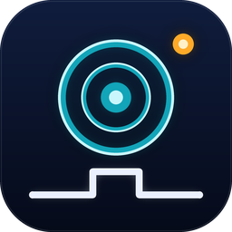

# SyncCam

Records video from a USB camera together with signals that an Arduino samples:

- the **TTL sync signal** that also goes to the Neuropixels (OneBox / Open Ephys), on A0
- a **microphone**, on A1
- an **IR LED** that the Arduino switches on and off, on D8

Every video frame, every Arduino sample and every TTL edge is saved on the same clock.
For each TTL pulse you get the video frame at that moment, and the sound at the same
sample, so video, sound and the Neuropixels recording line up through the shared TTL.

Windows 10/11 and macOS (Apple silicon and Intel).

## Download

Get the installer for your computer from the [latest release](https://github.com/jerjely/SyncCam/releases/latest):

| Your computer | File |
|---|---|
| Windows 10 / 11 | `SyncCam-x.y.z-Windows-setup.exe` |
| Mac with Apple silicon (M1 or newer) | `SyncCam-x.y.z-macOS-AppleSilicon.pkg` |
| Mac with an Intel processor | `SyncCam-x.y.z-macOS-Intel.pkg` |

The installers are not code-signed:

- **Windows:** click **More info** → **Run anyway**. No administrator rights are needed.
- **Mac:** if macOS refuses to open the .pkg, go to **System Settings → Privacy & Security** and click **Open Anyway**.
  The first time you open a camera, macOS asks for camera access. Click **Allow**. If you clicked
  **Don't Allow**, turn SyncCam on under **Privacy & Security → Camera**, then open the camera again.

## Arduino

Upload `firmware/SyncCam_Arduino/SyncCam_Arduino.ino` once with the Arduino IDE (Arduino Uno or Nano).

These are the default pins. You can pick other pins in the app (**Arduino → Pins**:
TTL and microphone on any of A0–A7, IR LED on D2–D13). The choice is sent to the board each
time you connect, so you never need to re-upload the sketch. A6 and A7 exist only on the Nano.

| Arduino pin (default) | Connect to |
|---|---|
| A0 | TTL sync signal (the same TTL that goes to the Neuropixels), 0–5 V |
| A1 | Microphone module output (MAX4466, MAX9814 or similar, biased at about 2.5 V) |
| D8 | IR LED through a resistor (for example 180 Ω for a 20 mA LED), or a transistor/MOSFET for brighter LEDs |
| GND | Common ground with the TTL source and the microphone |

The sketch samples both analog inputs at the chosen rate (1–10 kHz, default 5 kHz, 10-bit) and
streams them at 1,000,000 baud. Each sample carries a counter, so lost samples are detected and
reported. Commands are documented at the top of the sketch.

## Using it

1. **Camera:** pick the camera (**Scan** finds connected ones), size and frame rate, then **Open camera**.
2. **Arduino:** pick the port, check the pins match your wiring, and **Connect**. The board restarts when the port opens, which takes about 2 s.
   Set the TTL threshold (default 2.5 V). The red dashed line in the TTL plot shows it.
3. **IR LED:** click the button to switch it on or off. It stays as you set it, and SyncCam remembers
   the setting next time you connect.
4. **Recording:** choose a folder and a name, then **Record** and **Stop recording**.

**Simulator (no hardware)** and **Test pattern (no camera)** let you try everything without hardware.

## What gets saved

Each recording goes into its own folder, `<name>_<date>_<time>/`:

| File | Contents |
|---|---|
| `video.avi` (or `.mp4`) | The camera video |
| `frames.csv` | For every frame: `time_s`, wall clock, and the matching Arduino `sample` |
| `ttl_events.csv` | Every TTL rising and falling edge: `sample`, `time_s`, `video_frame`, `frame_time_s` |
| `microphone.wav` | The microphone, centred and amplified so you can listen to it |
| `analog.wav` | 3 channels at the sample rate, raw values: TTL (0–1023), microphone (0–1023), IR LED (0/1) |
| `session.json` | Settings, measured frame rate, Arduino clock fit, drop counts |

All `time_s` values are seconds since **Record** was pressed, on the computer's clock.
Arduino sample *n* happened at `first_sample_time_s + n / measured_rate_hz` (both in `session.json`).

**Use `frames.csv` for frame times,** not the frame rate written in the video file. USB cameras
never run at exactly their nominal rate. The file's header uses the rate measured just before recording.

### How video, sound and TTL line up

- **TTL and sound** are sampled together by the Arduino, so sample *n* of `microphone.wav`
  is the same moment as sample *n* of the TTL. The `sample` column of `ttl_events.csv` points
  straight into the sound file.
- **TTL and video:** each row of `ttl_events.csv` gives the `video_frame` at the moment of that
  edge (the first frame that reached the computer at or after it) and that frame's time.
- **Video and sound:** `frames.csv` gives the matching Arduino sample for every frame.

To line up with the Neuropixels, match the TTL edges in `ttl_events.csv` to the TTL events
in Open Ephys / SpikeGLX (they are the same pulses), then read off the video frame or the
sound sample for any Neuropixels time.

Frame times are when each frame reached the computer, which is a little after its exposure
(typically one or two frame intervals for USB cameras). If you need alignment to better than a
frame or two, measure this delay once for your camera, for example by filming an LED that the
TTL switches.

## Limits

- Arduino ADC: 10-bit (Uno, Nano, Nano Every, Uno R4 all work; ESP32 boards are not supported). The microphone channel works for detecting sounds and cues,
  but it is not a measurement microphone. At 5 kHz it records up to 2.5 kHz.
- Frame timing depends on the camera and its USB driver. Check `measured_fps` and the
  dropped-frame counts in `session.json`.
- If the disk cannot keep up, frames are dropped and counted, never silently skipped.
  `frames.csv` lists only the frames that are in the video.

## Running from source

Python 3.10 or newer.

- Windows: `install_windows.bat`, then `start_windows.bat`
- Mac: `install_mac.command`, then `start_mac.command`
  (if GitHub Desktop dropped the executable bit: `chmod +x *.command`)

Or: `pip install -r requirements.txt` and `python main.py`.

`python main.py --selftest` runs the built-in test with the test pattern and the simulated Arduino.

## Building the installers

The installers are built by GitHub Actions (`.github/workflows/build.yml`) on Windows,
macOS Apple silicon and macOS Intel. Each build runs the self-test on the built app and again
on the installed app before anything is published.

- **Actions → Build installers → Run workflow**, type a version such as `1.0.0` → builds, tests and publishes the release
- leave the version empty → build and test only (installers kept as workflow artifacts)
- or push a tag `v1.0.0`

## Licence

MIT. © 2026 Gergely Szarka
